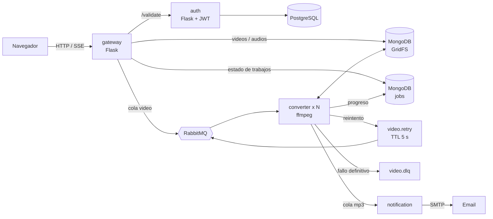

# Convertidor de video a audio — microservicios en Python

Sube un video y recibe el audio en MP3, M4A, OGG, Opus, FLAC o WAV. Puedes recortarlo, normalizar el volumen y ponerle título y artista. El progreso de la conversión se ve **en vivo** en el navegador, y si subes un archivo que ya se convirtió con las mismas opciones, el resultado sale **al instante** desde la caché.


## Qué lo hace interesante

| | |
|---|---|
| **Progreso en tiempo real** | El converter lee la salida `-progress` de ffmpeg, guarda el porcentaje en MongoDB y el gateway lo transmite por Server-Sent Events. Funciona con varias réplicas del gateway porque el estado vive en Mongo, no en memoria. |
| **Caché por contenido** | La clave es `sha256(archivo + opciones)`. Mismo video y mismas opciones: no se encola nada, se reutiliza el audio existente. |
| **Reintentos con espera y dead-letter queue** | Un fallo transitorio va a `video.retry`, una cola con TTL que devuelve el mensaje a `video` a los 5 s. Tras 3 intentos va a `video.dlq`. Los errores permanentes (archivo sin audio, formato inválido) no se reintentan. |
| **Audio de calidad** | Normalización de sonoridad EBU R128 (−16 LUFS, el estándar de las plataformas de streaming), recorte con búsqueda rápida, etiquetas ID3. |
| **Sin bloqueos de RabbitMQ** | La conversión corre en un hilo aparte para que pika siga respondiendo heartbeats; los videos largos no tumban la conexión. |
| **Seguridad** | JWT con expiración, contraseñas con scrypt, login en tiempo constante (no se pueden enumerar usuarios), trabajos privados por usuario, contenedores sin root. |

## Arquitectura



| Servicio | Qué hace |
|---|---|
| [`src/auth`](src/auth) | Registro, login (Basic → JWT) y validación de tokens. PostgreSQL vía SQLAlchemy. |
| [`src/gateway`](src/gateway) | API REST, web UI, subida a GridFS, caché, SSE de progreso, descarga en streaming. |
| [`src/converter`](src/converter) | Worker que convierte con ffmpeg. Escala horizontalmente: cada réplica procesa un video a la vez. |
| [`src/notification`](src/notification) | Envía un email cuando el audio está listo. |
| [`src/rabbit`](src/rabbit) | Manifiestos de RabbitMQ para Kubernetes. |

## Empezar en 1 minuto

Solo necesitas Docker.

```bash
docker compose up -d --build
```

| URL | |
|---|---|
| http://localhost:8080 | La aplicación |
| http://localhost:8025 | Mailpit: aquí llegan los emails de notificación |
| http://localhost:15672 | Panel de RabbitMQ (`guest` / `guest`) |

Hay un usuario admin creado de fábrica (`admin@example.com` / `admin12345`), o crea tu cuenta desde la UI.

### Prueba de punta a punta

```bash
python scripts/e2e.py
```

Genera un video de 10 minutos con el ffmpeg del contenedor y comprueba el flujo completo: registro, subida con recorte y normalización, progreso intermedio por SSE, descarga con etiquetas ID3, caché instantánea, privacidad entre usuarios, error permanente sin reintentos y llegada del email.

## API

Todas las rutas `/api/jobs*` requieren `Authorization: Bearer <token>`.

| Método | Ruta | |
|---|---|---|
| `POST` | `/api/register` | `{"email", "password"}` → 201 |
| `POST` | `/api/login` | Basic Auth → `{"token", "expires_in"}` |
| `GET` | `/api/formats` | Formatos y bitrates disponibles |
| `POST` | `/api/jobs` | Multipart: `file` + opciones → 202 encolado, o 200 si salió de la caché |
| `GET` | `/api/jobs` | Tus últimos 50 trabajos |
| `GET` | `/api/jobs/<id>` | Estado de un trabajo |
| `GET` | `/api/jobs/<id>/events` | Stream SSE con el progreso hasta que termina |
| `GET` | `/api/jobs/<id>/download` | Descarga el audio |

Opciones de conversión (campos del formulario, todos opcionales):

| Campo | Valores | Por defecto |
|---|---|---|
| `format` | `mp3`, `m4a`, `ogg`, `opus`, `flac`, `wav` | `mp3` |
| `bitrate` | kbps; se ajusta al valor permitido más cercano. Ignorado en `flac`/`wav` | `192` |
| `start`, `end` | Segundos (`90`), `mm:ss` o `hh:mm:ss` | todo el archivo |
| `normalize` | `1` / `true` / `on` | desactivado |
| `title`, `artist` | Texto, máximo 200 caracteres | — |

Ejemplo con curl:

```bash
TOKEN=$(curl -s -X POST -u admin@example.com:admin12345 localhost:8080/api/login | jq -r .token)

JOB=$(curl -s -H "Authorization: Bearer $TOKEN" \
  -F file=@video.mp4 -F format=mp3 -F bitrate=320 -F start=0:30 -F normalize=1 \
  localhost:8080/api/jobs | jq -r .id)

curl -N -H "Authorization: Bearer $TOKEN" localhost:8080/api/jobs/$JOB/events
curl -OJ -H "Authorization: Bearer $TOKEN" localhost:8080/api/jobs/$JOB/download
```

## Desarrollo

```bash
python -m venv .venv
.venv/Scripts/activate          # Windows  (Linux/macOS: source .venv/bin/activate)
pip install -r requirements-dev.txt

pytest                          # tests unitarios, sin Docker
ruff check src scripts          # estilo
```

Los tests no necesitan Mongo, RabbitMQ ni Postgres: los servicios reciben sus dependencias por inyección y los tests usan fakes en memoria (SQLite para auth). Los tests que llaman a ffmpeg de verdad se saltan si no está instalado; para correrlos dentro de la imagen del converter:

```bash
docker compose run --rm --no-deps --user root -v "$PWD/src/converter:/app" converter \
  sh -c "pip install -q pytest && python -m pytest -q tests"
```

Si tienes `make`: `make up`, `make test`, `make lint`, `make e2e`, `make logs`.

## Kubernetes (minikube)

Los manifiestos asumen MongoDB y PostgreSQL fuera del cluster, accesibles en `host.minikube.internal` (puedes levantarlos con `docker compose up -d mongo postgres`).

```bash
minikube addons enable ingress
make k8s-images     # construye las 4 imagenes dentro de minikube
make k8s-apply      # aplica todos los manifiestos
```

Agrega `mp3converter.com` y `rabbitmq-manager.com` a tu archivo hosts apuntando a la IP de `minikube ip` (o `127.0.0.1` con `minikube tunnel`).

Antes de usarlo en serio cambia los valores de ejemplo de los `secret.yaml` (sobre todo `JWT_SECRET`) y para Gmail usa una contraseña de aplicación en `notification-secret`.

## Configuración

| Variable | Servicio | Por defecto |
|---|---|---|
| `JWT_SECRET` | auth | **obligatoria** |
| `DATABASE_URL` | auth | `sqlite:///auth.db` |
| `JWT_TTL_SECONDS` | auth | `86400` |
| `ADMIN_EMAIL`, `ADMIN_PASSWORD` | auth | — |
| `AUTH_SVC_ADDRESS` | gateway | `auth:5000` |
| `MONGO_URI` | gateway, converter | `mongodb://localhost:27017` |
| `RABBITMQ_HOST` | gateway, converter, notification | `localhost` |
| `MAX_UPLOAD_MB` | gateway | `500` |
| `VIDEO_QUEUE`, `MP3_QUEUE` | gateway, converter, notification | `video`, `mp3` |
| `MAX_ATTEMPTS` | converter, notification | `3`, `5` |
| `RETRY_DELAY_MS` | converter | `5000` |
| `SMTP_HOST`, `SMTP_PORT`, `SMTP_USER`, `SMTP_PASSWORD`, `SMTP_STARTTLS`, `MAIL_FROM` | notification | Mailpit local |
| `PUBLIC_URL` | notification | `http://localhost:8080` |
