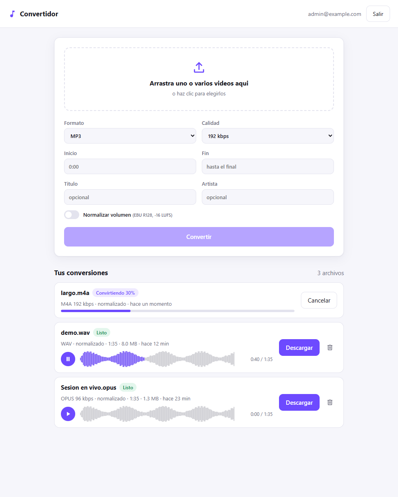
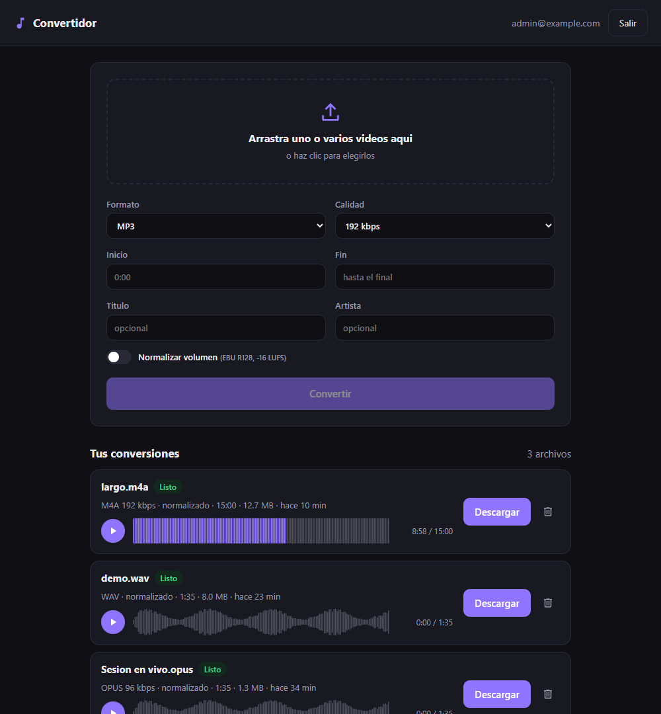
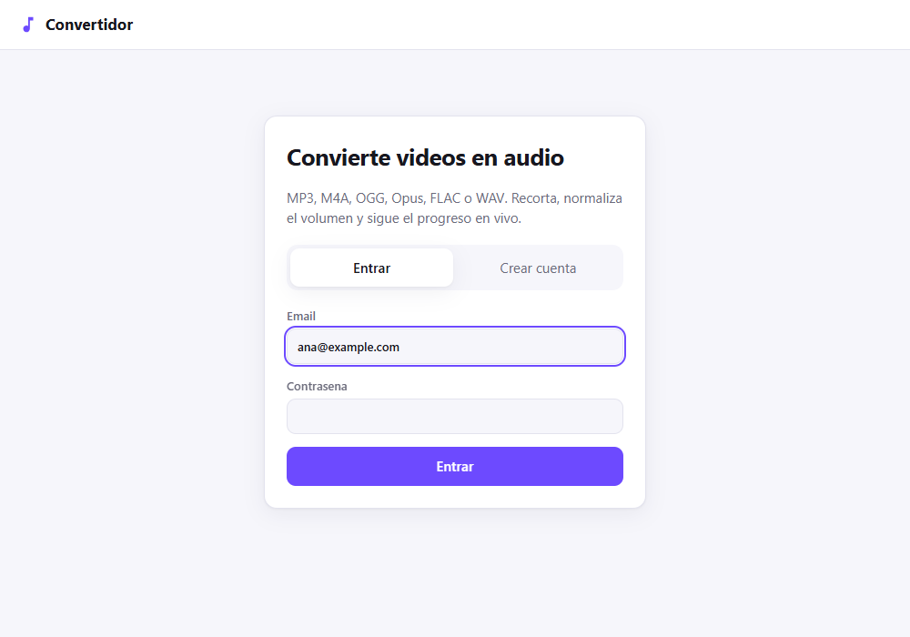
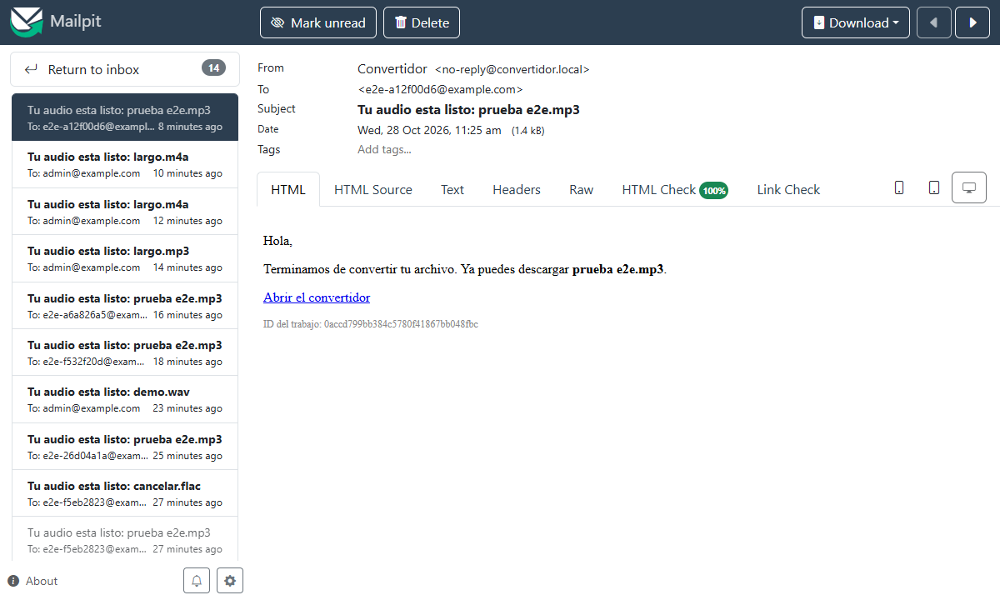
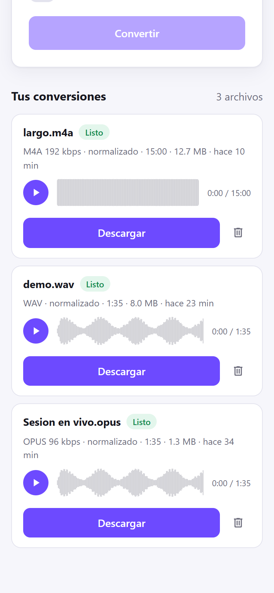
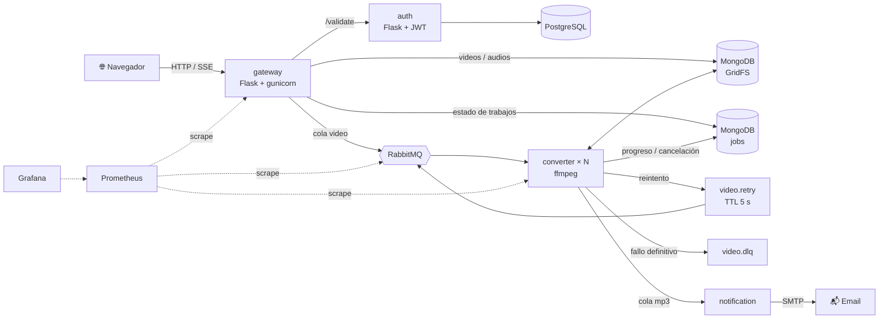
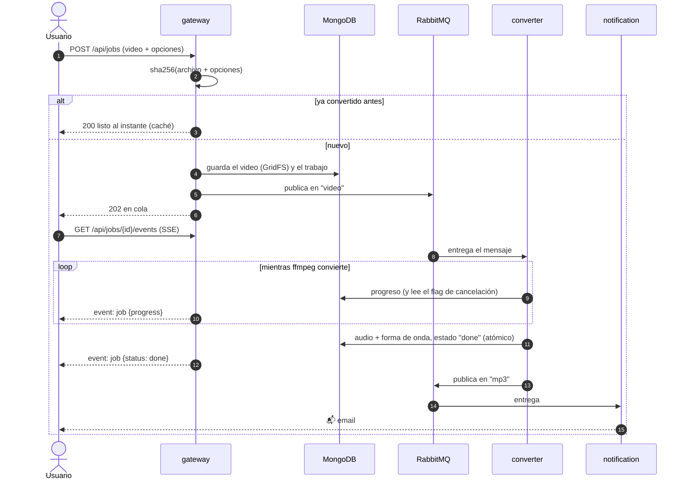
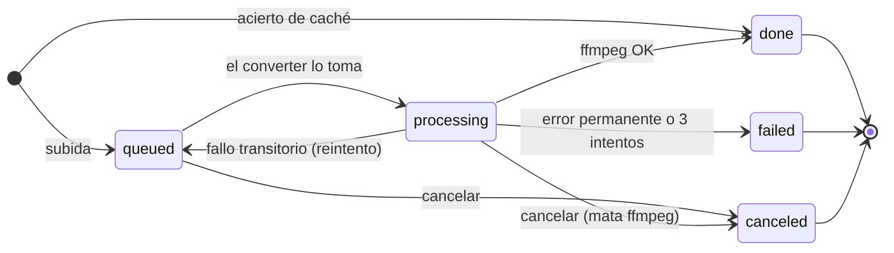
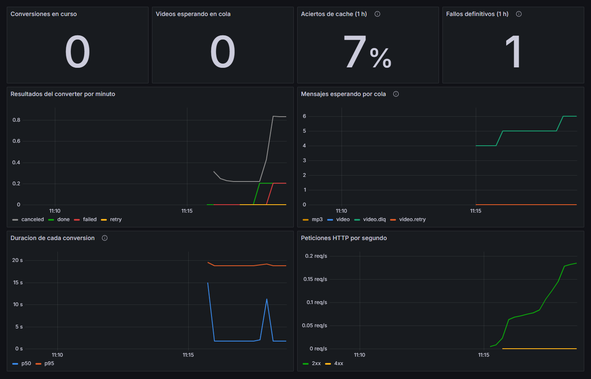

<div align="center">

# 🎵 Convertidor de video a audio

**Microservicios en Python que convierten videos a MP3, M4A, OGG, Opus, FLAC o WAV — con progreso en vivo, forma de onda interactiva, caché por contenido y observabilidad completa.**




</div>

---

## Contenido

- [Qué hace](#qué-hace)
- [Galería](#galería)
- [Inicio rápido](#inicio-rápido)
- [Arquitectura](#arquitectura)
- [Ciclo de vida de una conversión](#ciclo-de-vida-de-una-conversión)
- [API](#api)
- [Monitoreo](#monitoreo)
- [Decisiones técnicas](#decisiones-técnicas)
- [Estructura del repositorio](#estructura-del-repositorio)
- [Desarrollo y pruebas](#desarrollo-y-pruebas)
- [Kubernetes](#kubernetes-minikube)
- [Configuración](#configuración)

---

## Qué hace

Arrastras uno o varios videos, eliges el formato y las opciones, y en segundos tienes el audio. Por detrás, cuatro microservicios se comunican por HTTP y RabbitMQ.

| | |
|---|---|
| ⚡ **Progreso en tiempo real** | El converter lee la salida `-progress` de ffmpeg, guarda el porcentaje en MongoDB y el gateway lo transmite por **Server-Sent Events**. Funciona con varias réplicas del gateway porque el estado vive en Mongo, no en memoria. También con grabaciones `.webm` del navegador, que no traen duración: se mide recorriendo el audio sin decodificarlo. |
| 🌊 **Forma de onda interactiva** | El converter calcula 160 picos del audio en streaming. La UI los dibuja como reproductor: la parte escuchada se colorea, clic para saltar, flechas para avanzar ±5 s. |
| 🧠 **Caché por contenido** | La clave es `sha256(archivo + opciones)`. Mismo video con las mismas opciones → resultado al instante, sin encolar nada. Borrar un trabajo no rompe las copias de otros usuarios: el audio solo se elimina cuando nadie más lo usa. |
| ✋ **Cancelación real** | Cancelar un trabajo en curso **mata ffmpeg**. El cierre es atómico: si la cancelación llega mientras se guarda el resultado, ese audio se descarta. |
| 🔁 **Reintentos y dead-letter queue** | Un fallo transitorio va a `video.retry`, una cola con TTL que devuelve el mensaje a `video` a los 5 s. Tras 3 intentos va a `video.dlq`. Los errores permanentes (archivo sin audio, formato inválido) no se reintentan. |
| 🎚️ **Audio de calidad** | Normalización de sonoridad **EBU R128** (−16 LUFS, el estándar de las plataformas de streaming), recorte con búsqueda rápida, etiquetas de título y artista. |
| 📬 **Notificaciones** | Un email con enlace directo cuando el audio está listo. En local llegan a Mailpit. |
| 🔒 **Seguridad y límites** | JWT con expiración, contraseñas con scrypt, login en tiempo constante (no se pueden enumerar usuarios), trabajos privados por usuario, máximo de conversiones activas por usuario (429), contenedores sin root. |
| 📈 **Observabilidad** | Métricas Prometheus en gateway, converter y RabbitMQ, con un dashboard de Grafana ya configurado. |

## Galería

<table>
  <tr>
    <td width="50%"><br><sub><b>Modo oscuro automático.</b> La forma de onda se colorea a medida que suena el audio.</sub></td>
    <td width="50%"><br><sub><b>Acceso y registro</b> en la misma pantalla.</sub></td>
  </tr>
  <tr>
    <td><br><sub><b>Email de “tu audio está listo”</b>, visto en Mailpit. El enlace abre la app con ese trabajo resaltado.</sub></td>
    <td align="center"><br><sub><b>Responsive.</b> Vista en un celular.</sub></td>
  </tr>
</table>

## Inicio rápido

Solo necesitas **Docker**.

```bash
git clone https://github.com/zemogc/Convertidormp3_python.git
cd Convertidormp3_python
docker compose up -d --build
```

| URL | |
|---|---|
| http://localhost:8080 | **La aplicación** |
| http://localhost:8025 | Mailpit: aquí llegan los emails de notificación |
| http://localhost:15672 | Panel de RabbitMQ (`guest` / `guest`) |

Hay un usuario admin creado de fábrica (`admin@example.com` / `admin12345`), o crea tu cuenta desde la UI.

Con **monitoreo** (agrega Prometheus en `:9090` y Grafana en `:3000`):

```bash
docker compose --profile monitoring up -d --build
```

Para comprobar que todo funciona de punta a punta:

```bash
python scripts/e2e.py
```

```text
==> Progreso en vivo por SSE
  ok  estado final 'done' (error: None)
  ok  duracion recortada a 585 s (585.04)
  ok  forma de onda de 160 barras
  ok  se recibieron 24 eventos de progreso intermedio
==> Cache por contenido
  ok  respuesta instantanea desde cache (0.17s)
==> Cancelar una conversion en curso
  ok  cancelacion aceptada mientras convertia (202)
  ok  estado final 'canceled' (canceled)
==> Limite de conversiones activas por usuario
  ok  5 aceptadas y la sexta rechazada [202, 202, 202, 202, 202, 429]
  ...
Todo OK
```

El script solo usa la librería estándar y genera sus propios videos de prueba con el ffmpeg del contenedor.

## Arquitectura



| Servicio | Responsabilidad |
|---|---|
| [`src/auth`](src/auth) | Registro, login (Basic → JWT) y validación de tokens. PostgreSQL vía SQLAlchemy. |
| [`src/gateway`](src/gateway) | API REST y web UI. Sube videos a GridFS, aplica la caché y el límite por usuario, emite el progreso por SSE, sirve descargas en streaming, cancela y borra. |
| [`src/converter`](src/converter) | Worker que convierte con ffmpeg. Escala horizontalmente: cada réplica procesa un video a la vez. Calcula la forma de onda y gestiona reintentos y cancelaciones. |
| [`src/notification`](src/notification) | Envía el email cuando el audio está listo. |
| [`src/rabbit`](src/rabbit) | Manifiestos de RabbitMQ para Kubernetes. |
| [`monitoring`](monitoring) | Configuración de Prometheus y el dashboard de Grafana. |

## Ciclo de vida de una conversión



Estados de un trabajo:



## API

Las rutas `/api/jobs*` requieren `Authorization: Bearer <token>`.

| Método | Ruta | Respuesta |
|---|---|---|
| `POST` | `/api/register` | `{"email", "password"}` → 201 |
| `POST` | `/api/login` | Basic Auth → `{"token", "expires_in"}` |
| `GET` | `/api/formats` | Formatos y bitrates disponibles |
| `POST` | `/api/jobs` | Multipart `file` + opciones → **202** encolado, **200** desde la caché, **429** si superas el límite |
| `GET` | `/api/jobs` | Tus últimos 50 trabajos |
| `GET` | `/api/jobs/<id>` | Estado de un trabajo (incluye `waveform`) |
| `GET` | `/api/jobs/<id>/events` | Stream SSE con el progreso hasta que termina |
| `GET` | `/api/jobs/<id>/download` | Descarga el audio |
| `POST` | `/api/jobs/<id>/cancel` | **200** si estaba en cola, **202** si se está deteniendo ffmpeg, **409** si ya terminó |
| `DELETE` | `/api/jobs/<id>` | **204**. Los trabajos activos hay que cancelarlos antes (409) |
| `GET` | `/metrics` | Métricas Prometheus |

Los trabajos de otro usuario responden 404: la API no revela que existen.

### Opciones de conversión

Todos los campos son opcionales.

| Campo | Valores | Por defecto |
|---|---|---|
| `format` | `mp3`, `m4a`, `ogg`, `opus`, `flac`, `wav` | `mp3` |
| `bitrate` | kbps; se ajusta al valor permitido más cercano. Ignorado en `flac` y `wav` | `192` |
| `start`, `end` | Segundos (`90`), `mm:ss` o `hh:mm:ss` | todo el archivo |
| `normalize` | `1` / `true` / `on` | desactivado |
| `title`, `artist` | Texto, máximo 200 caracteres | — |

### Ejemplo con curl

```bash
TOKEN=$(curl -s -X POST -u admin@example.com:admin12345 localhost:8080/api/login | jq -r .token)

JOB=$(curl -s -H "Authorization: Bearer $TOKEN" \
  -F file=@video.mp4 -F format=mp3 -F bitrate=320 -F start=0:30 -F normalize=1 \
  localhost:8080/api/jobs | jq -r .id)

curl -N  -H "Authorization: Bearer $TOKEN" localhost:8080/api/jobs/$JOB/events     # progreso en vivo
curl -OJ -H "Authorization: Bearer $TOKEN" localhost:8080/api/jobs/$JOB/download   # descarga
```

## Monitoreo

`docker compose --profile monitoring up -d --build` levanta Prometheus y Grafana (http://localhost:3000, sin login) con el dashboard **Convertidor** ya cargado:



| Métrica | Servicio | Qué mide |
|---|---|---|
| `converter_jobs_total{result}` | converter | Trabajos por resultado: `done`, `failed`, `canceled`, `retry` |
| `converter_job_duration_seconds` | converter | Histograma de duración por intento |
| `converter_jobs_in_progress` | converter | Conversiones corriendo ahora |
| `converter_audio_seconds_total` | converter | Segundos de audio producidos |
| `gateway_jobs_created_total{format,cached}` | gateway | Trabajos creados y aciertos de caché |
| `gateway_jobs_rejected_total{reason}` | gateway | Rechazos por límite o por cola caída |
| `gateway_http_requests_total` / `_duration_seconds` | gateway | Tráfico y latencia por ruta (plantilla, no id: cardinalidad acotada) |
| `rabbitmq_queue_messages_ready{queue}` | RabbitMQ | Mensajes esperando en `video`, `video.retry`, `video.dlq` y `mp3` |

Prometheus descubre cada réplica del converter por DNS. El gateway corre varios workers de gunicorn, así que sus métricas usan el modo multiproceso de `prometheus_client`: `/metrics` suma los valores de todos los procesos.

## Decisiones técnicas

<details>
<summary><b>ffmpeg directo en lugar de moviepy</b></summary>

moviepy carga el clip en memoria y arrastra numpy, imageio y decorator. Llamar a ffmpeg como subproceso da control total (búsqueda rápida con `-ss`/`-t` antes de `-i`, `loudnorm`, metadatos), deja la imagen más liviana y permite leer el progreso real con `-progress pipe:1`. Los argumentos se pasan como lista, nunca por shell, así que un título como `"; rm -rf /` es solo texto.
</details>

<details>
<summary><b>Server-Sent Events en lugar de WebSockets</b></summary>

El progreso va en una sola dirección (servidor → navegador), y SSE es HTTP normal: atraviesa proxies e ingress sin configuración especial (solo `proxy-buffering: off`). La UI lo lee con `fetch` en lugar de `EventSource` para poder mandar el token en el header, y se reconecta con backoff exponencial.
</details>

<details>
<summary><b>Reintentos con una cola con TTL, no con <code>sleep</code></b></summary>

Si el worker esperara con `sleep` antes de reintentar, bloquearía ese hilo y ese mensaje. En cambio, el mensaje se publica en `video.retry`, que tiene `x-message-ttl` y como dead-letter la cola `video`: RabbitMQ lo devuelve solo cuando vence el TTL y el worker queda libre para otro video.
</details>

<details>
<summary><b>La conversión corre en otro hilo</b></summary>

`pika.BlockingConnection` atiende los heartbeats en el mismo hilo que ejecuta el callback. Una conversión de varios minutos dentro del callback hacía que RabbitMQ cortara la conexión. Ahora el trabajo corre en un hilo aparte y las publicaciones y el ack vuelven al hilo de pika con `add_callback_threadsafe`.
</details>

<details>
<summary><b>Cancelación sin carreras</b></summary>

Cada transición es una actualización condicional en Mongo:

- `queued → canceled` solo si sigue en cola.
- El converter solo toma trabajos en `queued`/`processing`.
- `processing → done` solo si `cancel_requested ≠ true`.

El reporte de progreso devuelve el flag de cancelación en la misma consulta, así que no hacen falta consultas extra. Si la cancelación llega después de ffmpeg, mientras se sube el resultado, el audio se borra en lugar de quedar huérfano.
</details>

<details>
<summary><b>Caché por contenido compartida entre usuarios</b></summary>

La clave combina el hash del archivo con las opciones canonizadas (por ejemplo, `start=0` equivale a no recortar). Dos usuarios que suben el mismo video comparten el audio, pero cada uno tiene su propio trabajo privado. Al borrar, el audio solo se elimina si ningún otro trabajo lo referencia.
</details>

## Estructura del repositorio

```text
.
├── docker-compose.yml        # todo el sistema; perfil "monitoring" para Prometheus + Grafana
├── Makefile                  # atajos: up, test, lint, e2e, k8s-images, k8s-apply
├── scripts/e2e.py            # prueba de punta a punta contra el stack real
├── monitoring/               # prometheus.yml y dashboard de Grafana
├── docs/                     # capturas del README
└── src/
    ├── auth/                 # auth_service/  tests/  manifests/  Dockerfile
    ├── gateway/              # gateway/ (API + static/ con la web UI)  tests/  manifests/
    ├── converter/            # converter/ (ffmpeg, worker, métricas)  tests/  manifests/
    ├── notification/         # notification/ (consumer + mailer)  tests/  manifests/
    └── rabbit/manifest/      # StatefulSet, Service, PVC e Ingress de RabbitMQ
```

## Desarrollo y pruebas

```bash
python -m venv .venv
.venv/Scripts/activate          # Windows  (Linux/macOS: source .venv/bin/activate)
pip install -r requirements-dev.txt

pytest                          # 97 tests unitarios, sin Docker
ruff check src scripts          # estilo
```

Los tests unitarios no necesitan Mongo, RabbitMQ ni Postgres: los servicios reciben sus dependencias por inyección y los tests usan fakes en memoria (SQLite para auth).

Los tests que llaman a ffmpeg de verdad se saltan si no está instalado. Hay 39 en total, entre ellos uno que verifica que tras cancelar no queda ningún proceso `ffmpeg` vivo. Para correrlos dentro de la imagen del converter:

```bash
docker compose run --rm --no-deps --user root -v "$PWD/src/converter:/app" converter \
  sh -c "pip install -q pytest && python -m pytest -q tests"
```

Si tienes `make`: `make up`, `make test`, `make lint`, `make e2e`, `make logs`.

## Kubernetes (minikube)

Los manifiestos asumen MongoDB y PostgreSQL fuera del cluster, accesibles en `host.minikube.internal`. Puedes levantarlos con `docker compose up -d mongo postgres`.

```bash
minikube addons enable ingress
make k8s-images     # construye las 4 imágenes dentro de minikube
make k8s-apply      # aplica todos los manifiestos
```

Agrega `mp3converter.com` y `rabbitmq-manager.com` a tu archivo hosts, apuntando a la IP de `minikube ip` (o a `127.0.0.1` con `minikube tunnel`).

Los deployments traen probes de readiness y liveness, límites de recursos, rolling updates sin downtime y anotaciones `prometheus.io/*`.

> [!IMPORTANT]
> Antes de usarlo en serio cambia los valores de ejemplo de los `secret.yaml`, sobre todo `JWT_SECRET`. Para Gmail usa una contraseña de aplicación en `notification-secret`.

## Configuración

| Variable | Servicio | Por defecto |
|---|---|---|
| `JWT_SECRET` | auth | **obligatoria** |
| `DATABASE_URL` | auth | `sqlite:///auth.db` |
| `JWT_TTL_SECONDS` | auth | `86400` |
| `ADMIN_EMAIL`, `ADMIN_PASSWORD` | auth | — |
| `AUTH_SVC_ADDRESS` | gateway | `auth:5000` |
| `MONGO_URI` | gateway, converter | `mongodb://localhost:27017` |
| `RABBITMQ_HOST` | gateway, converter, notification | `localhost` |
| `MAX_UPLOAD_MB` | gateway | `500` |
| `MAX_ACTIVE_JOBS` | gateway | `5` |
| `VIDEO_QUEUE`, `MP3_QUEUE` | gateway, converter, notification | `video`, `mp3` |
| `MAX_ATTEMPTS` | converter, notification | `3`, `5` |
| `RETRY_DELAY_MS` | converter | `5000` |
| `METRICS_PORT` | converter | `9100` |
| `SMTP_HOST`, `SMTP_PORT`, `SMTP_USER`, `SMTP_PASSWORD`, `SMTP_STARTTLS`, `MAIL_FROM` | notification | Mailpit local |
| `PUBLIC_URL` | notification | `http://localhost:8080` |
